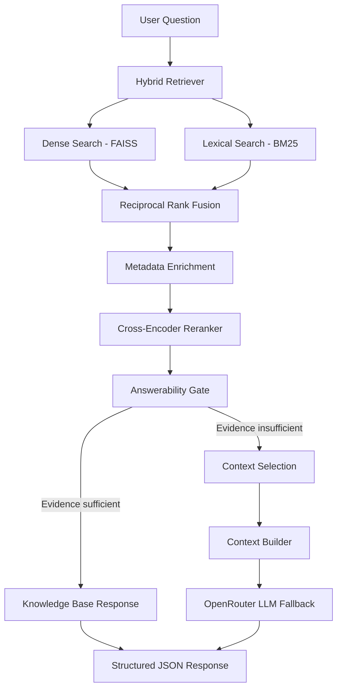

# 🔥 Flame in Freefall
### AI-Powered Fire Safety Insights from Microgravity Combustion Data

**Flame in Freefall** is an AI-powered scientific question-answering system designed to retrieve, analyze, and explain experimental combustion data. It combines Retrieval-Augmented Generation (RAG), hybrid information retrieval, cross-encoder reranking, evidence validation, and structured responses to make combustion experiments easier to explore.

The project aims to support scientific investigation of flame behavior under different experimental conditions, including oxygen concentration, pressure, flow velocity, and other available combustion parameters.

> **Project status:** Active development. The hybrid retrieval pipeline, cross-encoder reranking, answerability gate, structured knowledge-base responses, and LLM fallback have been implemented and tested on selected questions. Broader scientific trend analysis, ML prediction integration, and systematic evaluation remain in development.

---

## 📌 Table of Contents

- [Overview](#-overview)
- [Problem Statement](#-problem-statement)
- [Project Objectives](#-project-objectives)
- [Key Features](#-key-features)
- [System Architecture](#-system-architecture)
- [RAG Pipeline](#-rag-pipeline)
- [Technology Stack](#-technology-stack)
- [Knowledge Base](#-knowledge-base)
- [Example](#-example)
- [Structured Response](#-structured-response)
- [Project Structure](#-project-structure)
- [Installation](#-installation)
- [Configuration](#-configuration)
- [Running the Pipeline](#-running-the-pipeline)
- [Current Limitations](#-current-limitations)
- [Future Improvements](#-future-improvements)
- [Disclaimer](#-disclaimer)

---

## 🌌 Overview

Combustion experiments generate valuable information about flame propagation, ignition, heat release, soot formation, and fire risk. However, exploring a large collection of experimental documents manually can be time-consuming.

Flame in Freefall addresses this challenge by building a retrieval-based scientific assistant that allows users to ask natural-language questions about experimental data.

Instead of relying exclusively on an LLM to generate answers from its pretrained knowledge, the system first retrieves relevant evidence from its knowledge base. It then evaluates the retrieved evidence and selects an appropriate response path.

The system is designed to distinguish between:

- **Experimental observations:** Measurements recorded in the knowledge base.
- **Scientific interpretation:** Explanations grounded in the retrieved evidence.
- **ML predictions:** Model-generated estimates, when a prediction model is integrated.
- **Missing evidence:** Questions that cannot be answered confidently from the available experimental records.

## 🎯 Problem Statement

Understanding combustion behavior requires comparing experimental results across multiple conditions. Traditional document-based exploration can make it difficult to locate specific measurements, identify relevant experiments, and compare findings efficiently.

General-purpose LLMs introduce additional challenges because they may produce unsupported measurements, confuse observations with predictions, or provide answers without traceable evidence.

This project explores a more evidence-grounded approach by combining information retrieval, reranking, answerability checks, and structured response generation.

## 🚀 Project Objectives

1. Build a searchable knowledge base of combustion experiment documents.
2. Retrieve relevant evidence using both semantic and lexical search.
3. Improve retrieval relevance with a cross-encoder reranker.
4. Determine whether retrieved evidence supports the user's question.
5. Return structured answers with experiment identifiers, measurements, and source references.
6. Use an LLM fallback when the evidence is insufficient, while clearly communicating missing information.
7. Establish an architecture for integrating machine-learning predictions into the final scientific response.

---

## ✨ Key Features

### 1. Hybrid Retrieval

Combines two complementary retrieval methods:

- **Dense retrieval:** Finds semantically related passages using sentence embeddings and FAISS.
- **Lexical retrieval:** Uses BM25 to identify documents containing relevant terms and identifiers.

The two ranked lists are combined using Reciprocal Rank Fusion (RRF).

### 2. Cross-Encoder Reranking

Uses `cross-encoder/ms-marco-MiniLM-L-6-v2` to score query-document pairs and reorder retrieved candidates by relevance.

This adds a more detailed relevance assessment after the initial retrieval stage.

### 3. Answerability Gate

Evaluates whether the retrieved evidence is suitable for answering a question.

The current gate considers:

- Cross-encoder relevance scores.
- Query-term coverage.
- Presence of explicitly requested experiment IDs.
- Availability of the requested measurement and a numeric value for supported experiment-specific queries.

If evidence fails these checks, the pipeline can route the question to the LLM fallback.

The gate is a heuristic validation layer, not a guarantee of factual correctness. Its thresholds require further calibration against labeled test questions.

### 4. Evidence-Based Responses

For supported experiment-specific measurement questions, the knowledge-base path extracts the observed value directly from retrieved evidence.

This avoids an unnecessary LLM call for supported questions and reduces the risk of generating unsupported measurements.

### 5. LLM Fallback

When the current answerability gate rejects the evidence, the system can use an OpenRouter-hosted LLM to generate a structured response based on the retrieved context.

Configured models:

- Primary: `qwen/qwen-2.5-72b-instruct`
- Fallback: `qwen/qwen3-30b-a3b`

The fallback is intended to explain the available evidence and its limitations. It must not treat missing experimental values as known facts.

### 6. Structured JSON Output

Responses are organized into fields for answers, experimental evidence, predictions, observed trends, interpretations, safety insights, limitations, and sources.

This structure supports downstream applications, dashboards, APIs, and future integration with ML models.

---

## 🏗️ System Architecture



The knowledge-base response path and the LLM fallback path serve different purposes. The first extracts supported experimental measurements; the second handles cases that fail the current evidence checks.

---

## 🔍 RAG Pipeline

### Stage 1 — Knowledge Ingestion

Experimental records are represented as Markdown documents containing available metadata, experimental conditions, observed results, and risk information.

### Stage 2 — Chunking and Embedding

Documents are divided into retrieval chunks and embedded using:

`BAAI/bge-small-en-v1.5`

The current embedding configuration produces 384-dimensional vectors.

### Stage 3 — Hybrid Retrieval

Dense and BM25 retrieval identify potentially relevant chunks. Reciprocal Rank Fusion combines the rankings into a single candidate list.

### Stage 4 — Metadata Enrichment

Retrieved candidates are enriched with available experiment metadata and retrieval information, preserving identifiers and other useful fields.

### Stage 5 — Cross-Encoder Reranking

The reranker evaluates candidate relevance to the original question and selects the highest-ranked evidence.

### Stage 6 — Answerability Validation

The answerability gate checks relevance, lexical coverage, experiment identifiers, and supported measurement fields.

### Stage 7 — Response Generation

- **Knowledge-base path:** Extracts a supported measurement and returns a structured response.
- **LLM fallback:** Builds a context from retrieved evidence and sends it to the configured OpenRouter model.

### Stage 8 — Structured Output

The result contains the answer, evidence, available sources, limitations, and prediction information when applicable.

---

## 🛠️ Technology Stack

| Component | Technology |
|---|---|
| Programming language | Python |
| Embedding model | `BAAI/bge-small-en-v1.5` |
| Vector search | FAISS |
| Lexical search | BM25 |
| Hybrid ranking | Reciprocal Rank Fusion (RRF) |
| Reranking | `cross-encoder/ms-marco-MiniLM-L-6-v2` |
| LLM provider | OpenRouter |
| Primary LLM | Qwen 2.5 72B Instruct |
| Fallback LLM | Qwen3 30B A3B |
| API client | OpenAI-compatible Python client |
| Configuration | python-dotenv |
| Development and testing | Jupyter Notebook |

---

## 📚 Knowledge Base

The current project configuration reports the following dataset-processing results:

| Property | Current value |
|---|---:|
| Markdown documents | 300 |
| Processed chunks | 1,200 |
| Embedding vectors | 1,200 |
| Embedding dimension | 384 |
| Embedding model | `BAAI/bge-small-en-v1.5` |

These are the project's current reported processing counts and may change as the knowledge base evolves.

### Available experimental fields

The records can include:

- Experiment ID
- Investigation and material
- Oxygen concentration
- Pressure
- Flow velocity
- Ambient temperature
- Ignition time
- Flame spread rate
- Heat release rate
- Soot volume fraction
- Experimental outcome
- Fire risk score
- Fire risk level

The actual fields available may vary between records.

---

## 🧪 Example

Consider the question:

**"What was the flame spread rate in experiment EXP-0036?"**

The retrieved experiment record contains:

| Parameter | Observed value |
|---|---:|
| Experiment ID | `EXP-0036` |
| Oxygen concentration | 16.97% |
| Pressure | 85.5 kPa |
| Flow velocity | 13.93 cm/s |
| Flame spread rate | 2.746 mm/s |
| Heat release rate | 1.906 kW |
| Outcome | `steady_spread` |
| Risk level | Medium |

The pipeline retrieves the experiment, reranks the candidate chunks, validates the requested field, and extracts the observed flame spread rate.

The resulting decision is `knowledge_base`, and the answer is generated without requiring an LLM call.

---

## 📦 Structured Response

A knowledge-base response for the example question follows this format:

```json
{
  "answer": "EXP-0036: Observed flame spread rate: 2.746 mm/s.",
  "experimental_evidence": [
    {
      "experiment_id": "EXP-0036",
      "measurement": "flame spread rate",
      "value": 2.746,
      "unit": "mm/s",
      "finding": "Observed flame spread rate: 2.746 mm/s."
    }
  ],
  "prediction": null,
  "observed_trends": [],
  "interpretation": "Values are reported experimental observations, not machine-learning predictions.",
  "safety_insight": "Interpret the measurement within its experimental conditions.",
  "limitations": [
    "This response reports retrieved measurements only.",
    "No prediction was generated."
  ],
  "sources": [
    "EXP-0036"
  ],
  "source": "knowledge_base"
}
```

The `prediction` field is `null` because this example reports an observed measurement rather than a machine-learning prediction.

The `source` field identifies the response path. Experiment identifiers in `sources` identify the supporting records; they should be treated as dataset references, not automatically as published citations.

---

## 📁 Project Structure

The main project directories and files are organized as follows:

```text
rag/
│
├── answer/
│   └── answerability.py
│
├── context/
│   ├── context_selector.py
│   └── context_builder.py
│
├── embeddings/
│   └── processed/
│       └── chunks/
│           └── chunks.json
│
├── ingestion/
│
├── llm/
│   ├── llm_client.py
│   ├── prompt_builder.py
│   └── response_generator.py
│
├── retrieval/
│   ├── hybrid_retriever.py
│   ├── dense_retriever.py
│   ├── bm25_retriever.py
│   └── reranker.py
│
├── vector_store/
│   └── Metadata_filter.py
│
├── Test/
│
├── pipeline.py
├── pipeline_test.ipynb
└── .env
```

Some filenames or directory contents may differ as the project develops.

---

## ⚙️ Installation

### 1. Clone the repository

```bash
git clone <YOUR_REPOSITORY_URL>
cd <YOUR_REPOSITORY_NAME>
```

### 2. Create a virtual environment

```bash
python -m venv .venv
```

Activate it on Windows:

```bash
.venv\Scripts\activate
```

On Linux or macOS:

```bash
source .venv/bin/activate
```

### 3. Install dependencies

If a `requirements.txt` file is available:

```bash
pip install -r requirements.txt
```

Otherwise, install the dependencies required by your implementation, including the appropriate versions of:

```bash
pip install sentence-transformers faiss-cpu rank-bm25 openai python-dotenv jupyter
```

**Note:** This command is a starting point, not a verified complete dependency lockfile. Match the FAISS package to your environment, and add any other dependencies used by the ingestion and retrieval modules.

### 4. Prepare the knowledge base

Ensure the processed chunk file and the vector index or other retrieval artifacts required by your implementation are available.

The current metadata filter expects:

```text
embeddings/processed/chunks/chunks.json
```

The embedding model and reranker may need to download their weights on first use.

---

## 🔐 Configuration

Create a `.env` file in the `rag/` directory if that is where your `LLMClient` expects it.

```env
OPENROUTER_API_KEY=your_openrouter_api_key
```

Replace the placeholder with your own key.

The current LLM client loads the environment file relative to its Python file and uses the OpenRouter-compatible API.

**Security:** Never commit `.env` or API keys to GitHub. Add the following to `.gitignore`:

```gitignore
.env
.venv/
__pycache__/
.ipynb_checkpoints/
```

If a secret is accidentally committed, revoke or rotate it immediately.

---

## ▶️ Running the Pipeline

The current development workflow uses the Jupyter notebook:

```text
pipeline_test.ipynb
```

From the project environment, start Jupyter:

```bash
jupyter notebook
```

Open the notebook and run its setup cells to initialize the hybrid retriever, reranker, metadata filter, context components, answerability gate, and response generator.

A basic pipeline call looks like:

```python
question = (
    "What was the flame spread rate "
    "in experiment EXP-0036?"
)

result = rag_pipeline.answer(question)

print("Decision:", result["answerability"]["decision"])
print("Reason:", result["answerability"]["reason"])
print(result["response"])
```

The pipeline currently returns the structured response together with answerability information and reranked results.

---

## ⚠️ Current Limitations

This is an actively developed scientific prototype, not a validated fire-safety decision system.

- **Answerability calibration:** The relevance-score threshold and lexical coverage checks are heuristic and require evaluation on labeled data.
- **Measurement extraction:** Numeric extraction supports selected measurement names and text patterns. It is not a universal scientific-data parser.
- **General trend questions:** Multi-experiment aggregation and systematic trend analysis require further development.
- **LLM fallback:** Generated interpretations may contain unsupported claims unless evidence grounding and output validation are strengthened.
- **Schema consistency:** The knowledge-base response currently uses a flexible measurement structure, while the LLM response schema may differ. These should be unified.
- **ML integration:** Predictions are not automatically available unless a prediction model is trained, validated, and connected to the pipeline.
- **Scientific validity:** Correlation between experimental conditions and outcomes does not, by itself, establish causation.
- **Source traceability:** Experiment IDs identify internal records; published-source attribution requires appropriate source metadata.
- **Reproducibility:** Model versions, dependency versions, retrieval parameters, and evaluation datasets should be recorded for reproducible experiments.

---

## 🔭 Future Improvements

Planned development areas include:

- [ ] Aggregate evidence across multiple experiments for scientific trend questions.
- [ ] Validate extracted values and units against structured experiment metadata.
- [ ] Improve exact-ID lookup independently of semantic top-k retrieval.
- [ ] Calibrate answerability thresholds using labeled answerable and unanswerable questions.
- [ ] Evaluate retrieval with Recall@K, Precision@K, MRR, and nDCG.
- [ ] Evaluate answer correctness, source faithfulness, and fallback routing.
- [ ] Unify the structured output schema for the knowledge-base and LLM paths.
- [ ] Integrate a trained ML model for predicting selected combustion outcomes.
- [ ] Distinguish observed measurements, model predictions, and scientific interpretations in every response.
- [ ] Add a user-facing API or dashboard for interactive scientific exploration.
- [ ] Add automated tests for retrieval, evidence extraction, and end-to-end response generation.

---

## 📄 Disclaimer

Flame in Freefall is a research and development project intended to explore AI-assisted analysis of combustion experiment data.

It should not be used as the sole basis for operational fire-safety decisions, engineering certification, or emergency response. All findings and predictions require appropriate scientific validation.

The project's title and scientific motivation do not imply official NASA affiliation or endorsement. Cite the original dataset and source publications according to their applicable terms and attribution requirements.

---

## 👨‍💻 Contributions

Contributions, issue reports, and suggestions are welcome. Potential areas include improving retrieval quality, validating extracted measurements, evaluating scientific answer faithfulness, and integrating tested predictive models.

If you use or extend this project, please document the data sources, model configurations, evaluation methods, and limitations of your implementation.

**Built to explore how retrieval, language models, and scientific evidence can work together to make experimental combustion data more accessible.**
**Developed by Tarek Ahmed.**


